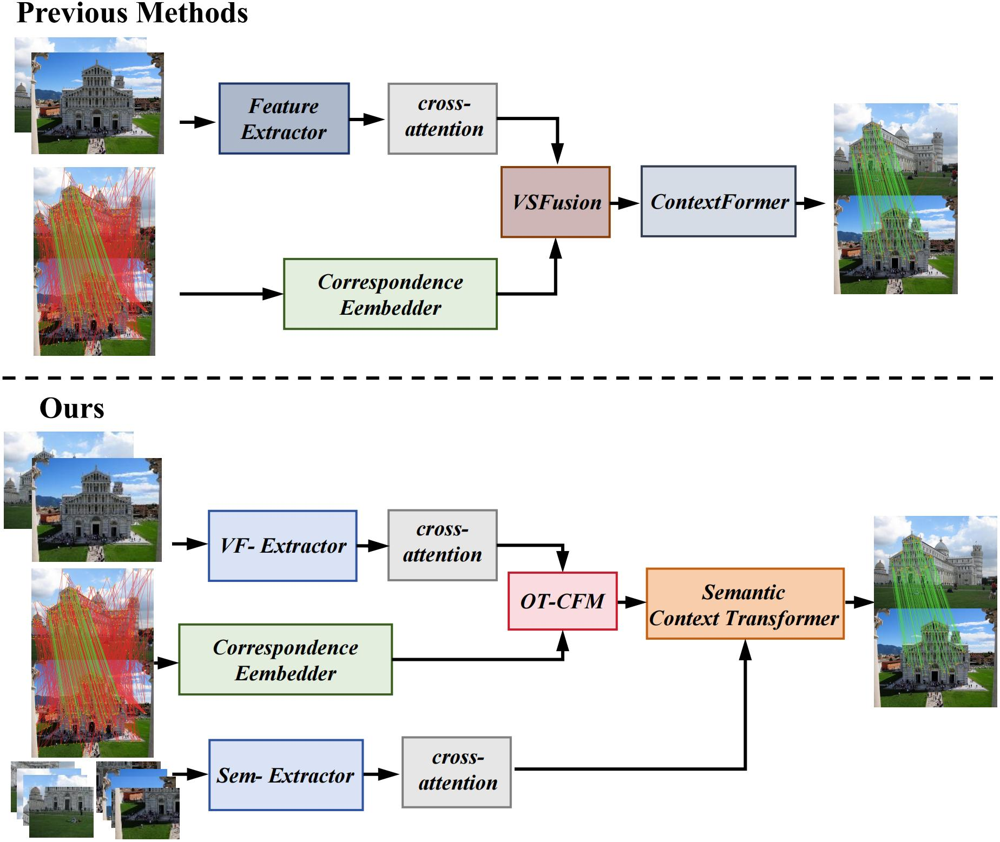

# MAVS-Net

**Modality-Aware Visual-Spatial Fusion Network for Two-View Correspondence Learning**


[](LICENSE)

Official PyTorch implementation of **MAVS-Net** for correspondence pruning and relative camera pose estimation.

[Overview](#overview) · [Architecture](#architecture) · [Results](#results) · [Installation](#installation) · [Dataset](#dataset-preparation) · [Training](#training) · [Evaluation](#evaluation)

## Overview

MAVS-Net combines visual appearance, spatial geometry, and semantic cues to identify reliable correspondences between two views.

<p align="center">
  
</p>

### Key Contributions

- **Optimal Transport Cross-Modal Fusion (OT-CFM)** uses the Sinkhorn algorithm to align visual and spatial features under doubly stochastic constraints.
- **Semantic-Gated Graph Attention (SGGA)** uses point-wise semantic affinity from a Vision Transformer (ViT) to gate edges in the spatial k-NN graph and reduce aggregation across semantically unrelated correspondences.

## Architecture

<p align="center">
  
</p>

| Component | Role |
| :--- | :--- |
| **VF-Extractor** | Extracts appearance cues from the image pair using ResNet34 and cross-attention. |
| **Sem-Extractor** | Extracts semantic features using ViT and cross-attention to guide graph gating. |
| **OT-CFM** | Aligns visual and spatial features with Sinkhorn-based optimal transport and learnable modality identity biases. |
| **Semantic Context Transformer** | Combines local graph attention from SGGA with global context aggregation. |

The Semantic Context Transformer refines correspondences in two stages.

1. **Stage 1 (`k = 9`)** prunes tentative correspondences.
2. **Stage 2 (`k = 6`)** predicts inlier probabilities and estimates the essential matrix.

## Results

### Camera Pose Estimation · mAP@5° (%)

MAVS-Net uses direct essential matrix estimation without RANSAC post-processing for the two unknown-scene results.

| Method | YFCC100M (Known) | YFCC100M (Unknown) | SUN3D (Known) | SUN3D (Unknown) |
| :--- | ---: | ---: | ---: | ---: |
| VSFormer | 48.83 | 62.18 | 24.81 | 20.18 |
| DeMo | 49.85 | 63.06 | 25.43 | 20.96 |
| SC-Net | 51.74 | 64.38 | 26.95 | 22.74 |
| **MAVS-Net (Ours)** | **52.93** | **65.87** | **28.42** | **23.91** |

### Outlier Removal · F-score (%)

| Method | YFCC100M (Known) | YFCC100M (Unknown) | SUN3D (Known) | SUN3D (Unknown) |
| :--- | ---: | ---: | ---: | ---: |
| SC-Net | 82.82 | 80.06 | 72.49 | 68.25 |
| **MAVS-Net (Ours)** | **84.49** | **81.61** | **74.68** | **70.24** |

## Installation

Use Anaconda or Miniconda and run these commands from the repository root.

```bash
conda create -n mavs_net python=3.8 --yes
conda activate mavs_net
conda install pytorch==1.7.1 torchvision==0.8.2 cudatoolkit=11.0 -c pytorch --yes
python -m pip install -r requirements.txt
```

## Dataset Preparation

Download and preprocess the datasets following the [OANet instructions](https://github.com/zjhthu/OANet). Place the generated HDF5 files in `data_dump/` at the repository root.

The YFCC100M files should have the following layout.

```text
data_dump/
├── yfcc-sift-2000-train.hdf5
├── yfcc-sift-2000-val.hdf5
└── yfcc-sift-2000-test.hdf5
```

## Training

Run the training commands from the repository root.

### Single GPU

```bash
mkdir -p logs
nohup python -u train_single_gpu.py > ./logs/mavs_net_yfcc.txt 2>&1 &
```

### Multi-GPU

```bash
mkdir -p logs
CUDA_VISIBLE_DEVICES=0,1 nohup python -u -m torch.distributed.launch \
  --nproc_per_node=2 --use_env train_multi_gpu.py \
  > ./logs/mavs_net_yfcc.txt 2>&1 &
```

### TensorBoard Monitoring

```bash
python train_with_monitor.py --batch_size 20 --epochs 29
```

The script starts TensorBoard automatically. To reopen the saved logs later, run `tensorboard --logdir=runs`.

<details>
<summary>Run monitored training in a Screen session</summary>

Install Screen on Ubuntu or Debian with `sudo apt-get install screen`, then start a session.

```bash
screen -S mavs_net
```

Run the training command inside the session.

```bash
python train_with_monitor.py --batch_size 20 --epochs 29 --screen
```

Press **Ctrl+A**, then **D** to detach. Reattach with `screen -r mavs_net`.

</details>

## Evaluation

```bash
python test.py
```

## Project Structure

| Path | Purpose |
| :--- | :--- |
| [`config.py`](config.py) | Experiment configuration |
| [`models/mavs_net.py`](models/mavs_net.py) | MAVS-Net architecture |
| [`models/loss.py`](models/loss.py) | Classification and essential matrix losses |
| [`datasets/`](datasets/) | Correspondence data loading |
| [`dump_match/`](dump_match/) | Match extraction and data preprocessing |
| [`utils/`](utils/) | Training, evaluation, and distributed utilities |
| [`assets/`](assets/) | Figures used in this README |
| `data_dump/` | Prepared HDF5 datasets |
| `logs/`, `runs/` | Training and TensorBoard logs |
| `checkpoint/`, `best_model/`, `weights/` | Checkpoints, best models, and pretrained weights |

## Acknowledgments

This implementation builds on [OANet](https://github.com/zjhthu/OANet), [CLNet](https://github.com/sailor-z/CLNet), and [VSFormer](https://arxiv.org/abs/2312.08774).

## License

This project is licensed under the [MIT License](LICENSE).
